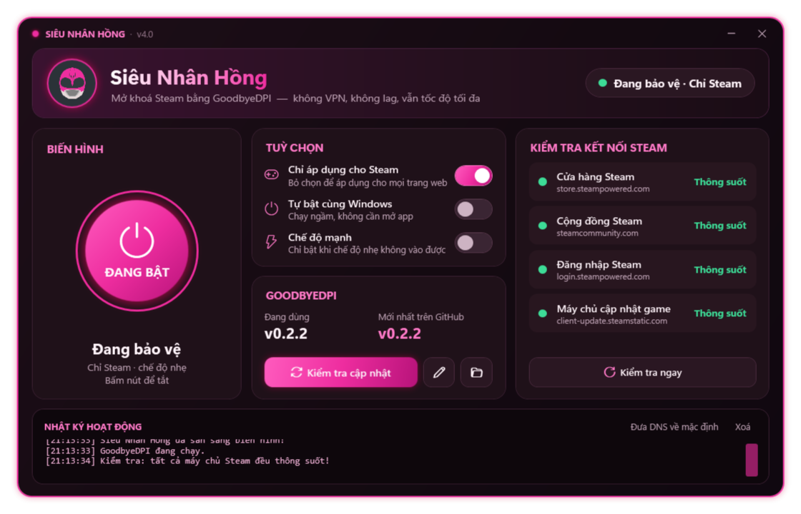

# Siêu Nhân Hồng — Mở khoá Steam



App Windows giúp vào Steam, đăng nhập và cập nhật game khi nhà mạng chặn Steam bằng DPI (lọc theo tên miền SNI).
Bên dưới dùng [GoodbyeDPI](https://github.com/ValdikSS/GoodbyeDPI): **không VPN, không lag, tốc độ tải giữ nguyên**.

## Tính năng
- **Bật/tắt bằng một nút** — tách gói bắt tay TLS để thiết bị lọc của nhà mạng không đọc được tên miền.
- **Chỉ áp dụng cho Steam** (mặc định) — bỏ chọn để áp dụng cho mọi trang web.
- **Tự bật cùng Windows** — chạy ngầm dưới dạng dịch vụ, không cần mở app.
- **Chế độ mạnh** (`-5`) dự phòng khi chế độ nhẹ không đủ.
- **Cập nhật GoodbyeDPI** trực tiếp từ GitHub (bản phát hành mới nhất của ValdikSS/GoodbyeDPI).
- **Kiểm tra kết nối** tới Cửa hàng, Cộng đồng, Đăng nhập và máy chủ cập nhật game của Steam.
- Sửa danh sách tên miền, đưa DNS về mặc định.

## Cài đặt & sử dụng
1. Tải `SieuNhanHong.exe`, chạy (app tự xin quyền Administrator).
2. Bấm nút **BIẾN HÌNH**. Lần đầu app tự giải nén GoodbyeDPI vào `C:\GoodbyeDPI`.
3. Mở Steam.

Gỡ bỏ: tắt nút trong app (tự gỡ dịch vụ), rồi xoá thư mục `C:\GoodbyeDPI`.

## Build từ mã nguồn
Không cần IDE — chỉ cần .NET Framework 4.x có sẵn trong Windows:

```bat
build.bat
```

## Lưu ý
- GoodbyeDPI dùng driver WinDivert nên một số phần mềm diệt virus có thể báo nhầm.
- Anti-cheat của Valorant (Vanguard) và FACEIT có thể không chấp nhận WinDivert — tắt app trước khi chơi các game đó.

## Giấy phép bên thứ ba
- GoodbyeDPI — Apache License 2.0
- WinDivert — LGPL v3

Toàn văn giấy phép nằm trong `goodbyedpi/licenses/`.
